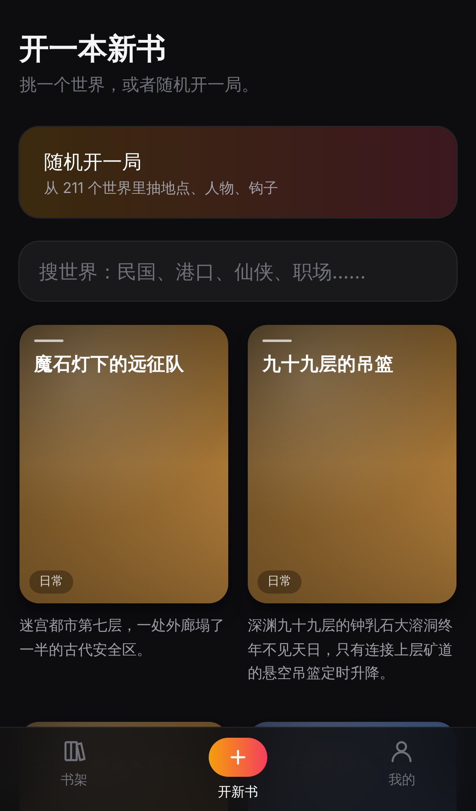
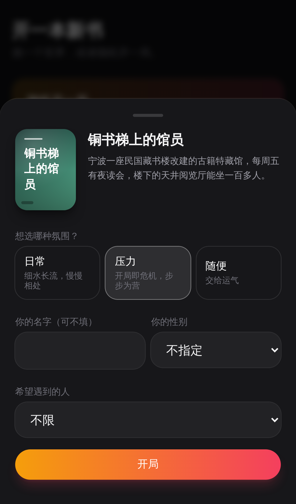
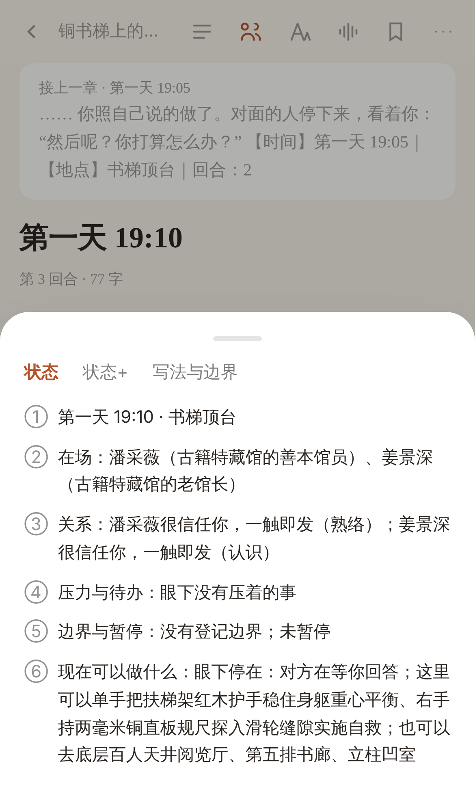

<div align="center">

# 书入

**一本跟着你的想法走的小说。**
你来定方向，AI 来写好；写多久、何时完结，都由你决定。

中文 · 手机优先的网页版 · 可打包为 Windows 桌面版

</div>

> ⚠️ 本项目目前是个人自用的实验项目，没有上线运营。开启成人向后的内容只面向成年人，所有角色均为明示的成年人。

## 为什么做这个

读网文时，常常会想“如果主角这里换个选择会怎样”；用通用聊天机器人写故事，又很快会遇到三个问题：

- **记不住**：写到后面人物性格、时间线、谁知道什么全乱了。
- **抢方向**：AI 替主角说话、做决定，甚至自己急着收尾。
- **没压力**：配角都围着主角转，故事很快变得平淡。

书入想解决的就是这些：

- **你是作者**：每一段结尾都把球交回给你，停在一个你能接的时刻；AI 不替主角做决定，也不催你完结。
- **世界有记忆**：用一个本地叙事引擎记录人物、关系、时间、事件和边界，每回合先记录、再按记录写正文，不靠模型“硬记”。
- **配角有自己的意志**：每个人物有自己的目的和秘密，会按自己的利益行动。
- **读起来像小说**：章节、目录、书签、字体与夜间模式、听书，跟平常看网文一样。

## 截图

| 开新书 | 开局设置 | 开局正文 | 状态 |
| --- | --- | --- | --- |
|  |  |  |  |

更多截图见 [`docs/screenshots/`](docs/screenshots/)。

## 怎么使用

1. **注册登录**，到“我的 → 设置”填入自己的模型 API Key（DeepSeek、通义千问、豆包、Kimi、智谱任选，保存前会先验证，加密存储）。
2. **开一本新书**：从 211 个世界里挑一个（可按“民国、港口、仙侠、职场……”搜索），或者“随机开一局”；选择氛围（日常 / 压力）和每回合篇幅。
3. **读开局**，在底部输入条写下主角接下来做什么、说什么。也可以用快捷方式：
   - **继续**：让场景自然推进；**等一等**：把空间留给别人
   - **其实……**：追补一件过去的事实
   - **快进**：到晚上 / 明早 / 三天后 / 一周后；**来点转折**
   - **改写上一段**、**撤销**、**暂停**
4. **看状态**：顶栏的“状态”里能看到此刻、在场的人、关系变化、悬而未决的事、你设定的边界，以及现在可以做什么。
5. **调写法**：节奏、基调、人称、篇幅、边界（“不要 X”）都可以按书单独设置。
6. **完结由你决定**：想收尾时选“下一章完结”或“用 3 章收尾”，完结后还可以写番外或新卷。

## 快速开始

### 环境要求

- Node.js 20+
- Python 3.10+（叙事引擎用，只依赖标准库）
- 一个上面任意一家模型的 API Key

### 本地运行

```bash
git clone https://github.com/liubaixiao111-dot/shuru.git
cd shuru
cp .env.example .env      # 至少把 APP_SECRET 换成一串随机字符
npm install
npm run db:push           # 创建本地 SQLite 数据库
npm run dev               # 打开 http://localhost:3000
```

注册账号后在“设置”里填自己的 Key 即可开始写。

### 配置项（`.env`）

| 变量 | 说明 |
| --- | --- |
| `DATABASE_URL` | 数据库地址，默认本地 SQLite `file:./dev.db` |
| `APP_SECRET` | 用来加密用户 API Key 和签名会话，**必须换成 32 字节以上的随机串** |
| `DEEPSEEK_API_KEY` / `QWEN_API_KEY` | 可选。“平台额度”模式用的模型 Key；只用自带 Key 时留空 |
| `AT_PYTHON` | 可选。指定 Python 路径，默认依次尝试 `python3`、`python`、`py -3` |
| `AT_HOME` | 可选。叙事引擎的存档目录，默认项目下的 `.at-data/` |
| `STORY_REVIEW` | 可选。设为 `off` 关闭旧版续写的自动审校 |

`.env` 已在 `.gitignore` 里，不要把真实的 Key 提交到仓库。

### Windows 桌面版

```bash
npm run electron:dev      # 开发模式
npm run electron:dist     # 打包 Windows 安装包，输出到 dist/
```

桌面版把网页和数据库打包在一起，数据保存在本机；电脑上仍需装有 Python 3.10+。

### 测试

```bash
npm test                  # 单元测试
npm run typecheck         # 类型检查
```

## 工作原理

```
作者输入 ──► 书入（Next.js）──► 模型：理解输入，提交“记录”（人物移动、关系变化、事件……）
                │
                ▼
         叙事引擎（Python，engine/adult-tension）：校验记录、推进时间、掷随机、存档
                │
                ▼
         模型：按引擎返回的结果写正文 ──► 流式显示给作者
```

模型只负责“理解”和“写”，状态、时间、随机和规则校验都交给本地引擎，所以长篇写下去设定也不会乱。

### 目录

```
engine/adult-tension/  叙事引擎（来自 dsh-adult-tension，原样复制）
src/lib/at/            书入作为“宿主”调用引擎：提示词拼装、记录与写正文两步
src/lib/llm/           模型厂商配置、自带 Key / 平台额度、用量记账
src/lib/story/         旧版续写管线（提示词、解析、审校）
src/app/               页面与接口（Next.js App Router）
src/components/        阅读器、开书、设置等组件
electron/              桌面版外壳
prisma/                数据库结构
docs/                  截图与宿主提示词样本
```

## 功能一览

<details>
<summary>展开查看全部功能</summary>


| 模块 | 内容 |
| --- | --- |
| 账号 | 邮箱注册登录，会话 Cookie |
| 开书 | 从叙事引擎的 211 个世界里挑选或搜索，或随机开一局；可选氛围（日常 / 压力）、每回合篇幅（默认 1000–1500 字）。旧版的 8 个原创场景和“我的人生”问答开书仍保留在代码里（`src/lib/scenes.ts`） |
| 写作 | 回合制续写：每段 500–1300 字（随节奏偏好），结尾停在一个作者能接的时刻（有人对主角说话、递来东西、等主角表态），不替主角说话、做决定或下情绪结论；流式输出 |
| 输入方式 | 自由输入行动或对白；继续（场景自然推进，主角不做重大决定）、等一等（把空间留给别人）、其实…（追补过去的事实，不能给人追加好感）、改写上一段、撤销（原段留在分支里）、快进（到晚上/明早/三天后/一周后）、来点转折（七类方向）、暂停（下一段不延续当前场面）。按钮和自然说法（“刚才不算，改成……”“快进到……”）都能识别 |
| 关系 | 每个配角对主角的关系有三条线：信任（-5..5）、亲近阶段、张力（0..5），每次变化要有原因；程序把关：一段之内信任和张力最多变 2，没有原因的变化不算，“其实……”不改变关系。界面上只显示人话，不露数值 |
| 写法偏好（每本书） | 节奏（慢热/标准/直接）、基调（有压力/日常）、人称（他/她 或 你）、内心可见、叙事助手（章末直接显示可以做的事）、离屏推演、边界（“不要 X”，审校时一并检查） |
| 分支 | 重写本章、从任意一章后改写、在分支间切换；每章保存设定集快照，切分支不串设定 |
| 一致性 | 设定集（世界观、主角、人物、事实、文风、故事状态）每章由 AI 更新，作者可改；较早章节用摘要、最近两章用全文 |
| 人物与张力 | 每个配角有自己的目的和秘密（只给 AI 看，界面不展示），会按自己的目的行动；故事状态记录时间、地点和未解决的线索，每章至少推进一条线索并加入新的压力 |
| 剧情主动修正 | 作者的想法分“直接发生”（主角自己的动作）和“尝试”（作用于他人，结果由对方决定）；与设定冲突时补最小的合理因果，不拒绝；“其实……”用于追补设定。每章写完后自动审校一遍（设定矛盾、信息越界、配角无理由倒戈、主角凭空开挂、想法被偷换、因果断裂），发现问题就带着问题清单重写一次。设置 `STORY_REVIEW=off` 可关闭 |
| 完结 | 只由作者发起：下一章完结，或用 3 章收尾；完结后可继续写番外或新卷；AI 不会主动催完结 |
| 付费 | 自带 API Key（DeepSeek、通义千问、豆包、Kimi、智谱，加密存储，保存前验证）；平台额度模式（DeepSeek 主力、通义备用，按 token 记账扣减） |
| 成人向 | 设置中开启，需年龄验证；关闭时尺度为“含蓄”，开启时按叙事引擎的尺度设置；所有角色均为明示成年人，遵守玩家边界与“暂停” |
| 阅读 | 字号、行距、宋体/黑体、四种背景（纸张、白色、护眼、夜间），设置存在本机；阅读进度记忆；书签；听书（浏览器语音合成） |
| 续写页 | 输入框贴在屏幕底部一条，工具（目录、状态与写法、字体、听书、书签、更多）放在顶栏，正文尽量多露；新内容接在原文后面写，不清屏；每章开头带上一章最后几句；状态面板六项：此刻、在场、关系、悬而未决、边界、可以做什么；语音输入；草稿自动保存在本机，生成失败不丢字 |
| 书架 | 继续阅读卡片、读到第几章、章数字数、按最近阅读/最近更新排序、渐变封面 |
| 其他 | 目录、导出 TXT、每章“AI 生成”标识、近 30 天用量 |


</details>

## 说明

- **AI 生成内容**：每一章都标有“AI 生成”，内容由模型写出，可能出错或不合适，请自行判断。
- **成人向**：默认关闭。在设置里通过年龄验证后才能开启；关闭时尺度为“含蓄”。无论是否开启，所有角色都是明示的成年人，玩家设定的硬边界和“暂停”都必须遵守。
- **隐私**：你的 API Key 用 `APP_SECRET` 加密后存在本地数据库；书和存档都在你自己的机器上。请求会直接发给你选的模型厂商，须遵守其服务条款。
- **不能商用**：引擎里的世界素材和叙事规则按 CC BY-NC 4.0 授权，详见下方“来源与许可”。

## 路线图 / 上线前待办


- **实名核验**：现在的年龄验证只校验身份证格式和年龄，需要接入第三方实名核验（姓名 + 证件号一致性，最好加人脸）。
- **内容安全**：`src/lib/moderation.ts` 只是占位，需接入正式内容安全服务，并审核模型输出。
- **生成式 AI 备案**与 ICP 备案。
- **数据库**：生产环境改用 PostgreSQL（修改 `prisma/schema.prisma` 的 provider）。
- **积分充值**：定价确定后接入支付，额度字段 `User.platformTokens` 已按 token 记账。
- **手机号登录**：国内用户更习惯短信验证码登录。
- **语音输入**：现在用浏览器自带的语音识别，iOS Safari 可用；安卓 Chrome 依赖境外服务，国内可能用不了。做 App 时换成国内语音识别（讯飞、阿里云），`src/hooks/useVoiceInput.ts` 的接口不用变。
- 第二阶段：广场（分享作品、邀请他人续写）、App。


## 来源与许可

书入的续写引擎、211 个世界和叙事 / 尺度规则来自 **[daha1216/dsh-adult-tension](https://github.com/daha1216/dsh-adult-tension)**（作者 [daha1216](https://github.com/daha1216)），原样放在 `engine/adult-tension/`，并由 `src/lib/at/prompts.ts` 拼成宿主提示词（导出样本见 [`docs/host-prompts/`](docs/host-prompts/)）。感谢原作者。

- 引擎的运行时代码：MIT License
- 引擎的世界素材、Skill 说明与叙事规则文档：[CC BY-NC 4.0](https://creativecommons.org/licenses/by-nc/4.0/deed.zh-hans)（须署名，**不得商用**）
- 第三方 npm 依赖：按各自许可证

完整的来源、版本、许可和改动说明见 **[CREDITS.md](CREDITS.md)**。书入自己的代码目前未指定开源许可证。
